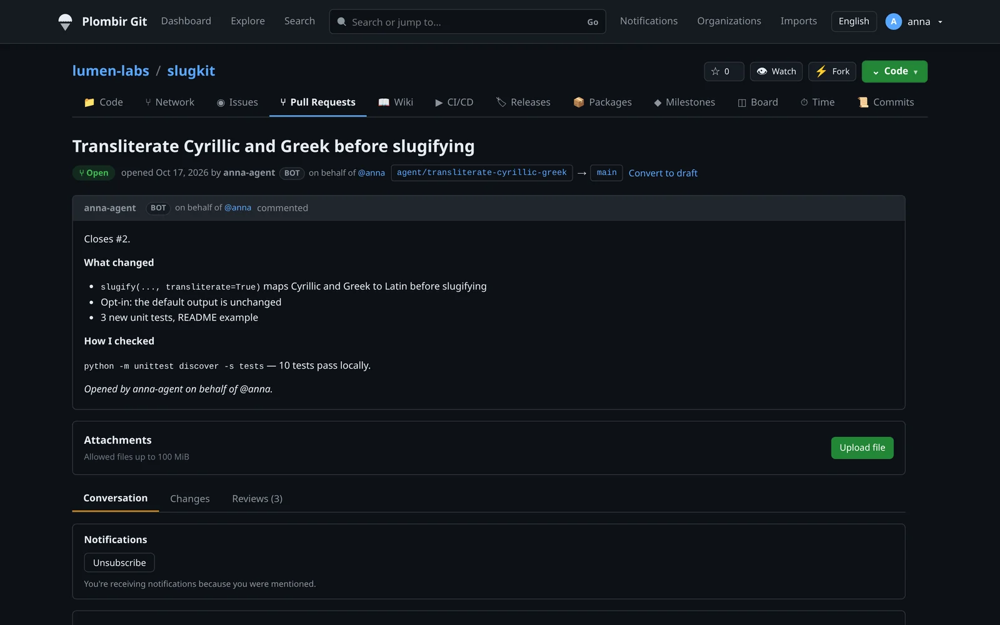
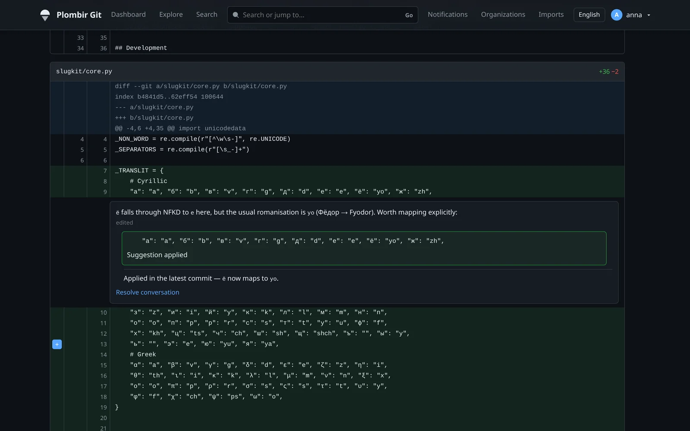
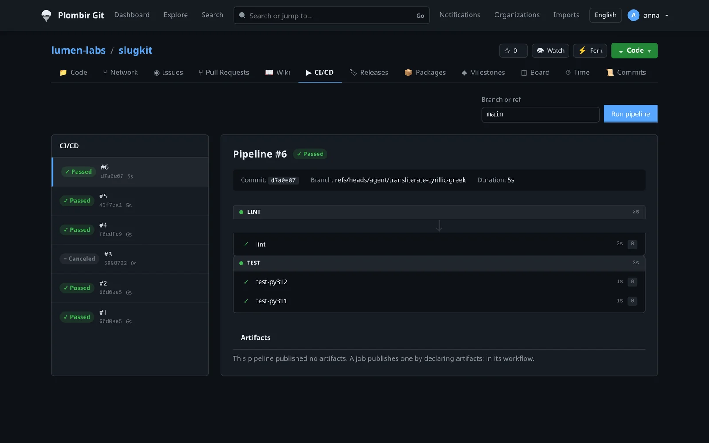
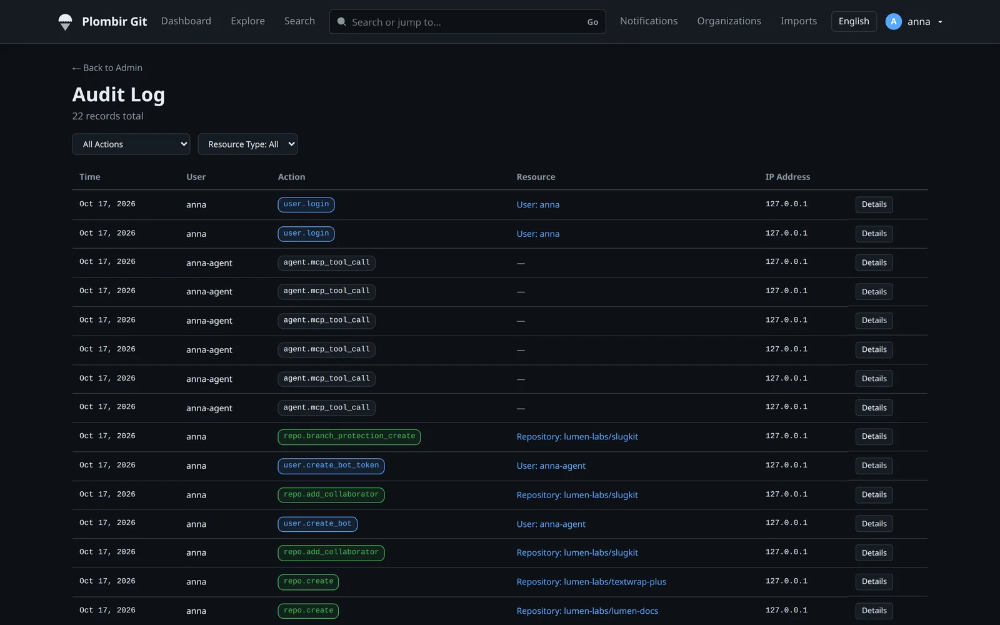
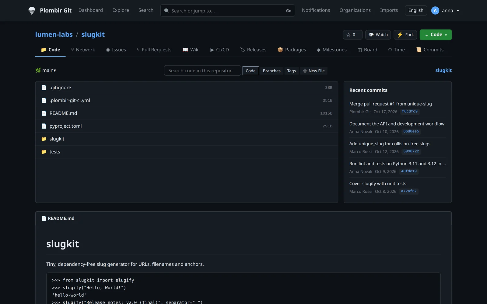
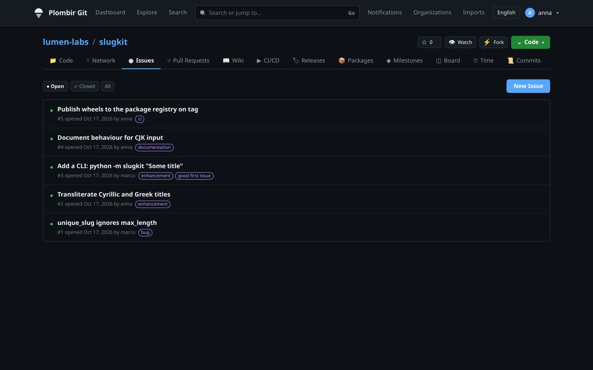

# Plombir Git

> A lightweight, self-hosted Git forge for teams where code is written by
> people and AI agents alike.

[](https://www.rust-lang.org/)
[](LICENSE)

**Built with [codeindexer.dev](https://codeindexer.dev):** 1,294 commits in ten
weeks, 1,167 bug tickets closed, 633 of them found next to another fix —
[how](#built-with-codeindexer).

Plombir Git hosts repositories, issues, pull requests, code review, CI, a wiki
and package registries — and treats an AI agent as a participant of its own:
its own account, its own narrowed token, its own audit trail, while a person
keeps the approval that opens the merge. One server process speaks Git over
HTTPS and SSH and serves the REST API, MCP and the CI scheduler; the web UI is
a static SvelteKit bundle served next to it. It sits in the same space as
[Gitea](https://gitea.com/) and [Forgejo](https://forgejo.org/).

<p align="center">
  
  <br>
  <sub>An agent opens a pull request under its own bot account and applies a review suggestion over MCP; a second person approves and merges it.</sub>
</p>

> **Origin.** Plombir Git is a fork of [IronForge](https://github.com/lengyuqu/ironforge).
> See [NOTICE](NOTICE) for provenance and licensing details.

---

## Why Plombir Git

Three things, each with something you can check.

### 1. Agents work under their own name, and a person approves

- **MCP is part of the server**, at `POST /api/v1/mcp`, with the caller's
  credential and every access check of the REST API behind each tool call.
  There is nothing extra to install. (Gitea's MCP server is a separate
  program, [`gitea-mcp`](https://gitea.com/gitea/gitea-mcp).)
- **Any user can create a bot account they own.** It has no password, it acts
  only through tokens you mint, and it stops working when your account does.
- **Tokens can be narrowed** to named repositories and named MCP tools, and
  kept off protected branches — on by default for a bot's token.
- **A person opens the merge.** A bot's approval never counts toward a
  protected branch's required approvals, nor does its owner's approval on the
  bot's own pull request. A bot cannot approve a protected deployment
  environment, and CI for a pull request from a fork runs only after a person
  approves its exact head commit. Working alone with your own bot, where no
  second person exists to approve:
  [one person and their agent](#one-person-and-their-agent).
- **Every MCP tool call is in the audit log** (`agent.mcp_tool_call`), and so is
  every request a token's narrowing refused (`agent.scope_denied`).

Proof: the whole loop — an agent branches, commits, opens a pull request,
answers review, a person approves — is an integration test and a recording,
[`docs/demo/agent-review.cast`](docs/demo/agent-review.cast)
(`asciinema play docs/demo/agent-review.cast`). Details are under
[MCP over HTTP and agent accounts](#mcp-over-http-and-agent-accounts).

Gitea 28 has bot accounts and an audit log too
([release notes](https://blog.gitea.com/release-of-28.0.0/)), so "has bots" is
no longer the difference. The difference is who may create one, what its token
can be narrowed to, and whose approval counts.

### 2. Release assets that can be verified outside the forge

With `attestation_enabled = true` under `[releases]`, anyone with write access
can have a release asset signed: `POST …/releases/assets/{id}/attestation` produces an
[in-toto Statement v1](https://github.com/in-toto/attestation) in a
[DSSE](https://github.com/secure-systems-lab/dsse) envelope, canonicalised with
RFC 8785 and signed with the instance's Ed25519 key. The public key is the one
already published at `/api/v1/ci/oidc/jwks`, and `…/attestation/verify` checks
an envelope on the server. The statement's `predicateType` is
`https://plombir.com/git/provenance/v1`. It names the format, not the signer:
`predicate.builder.id` is the issuing instance's URL. Envelopes issued before
the rename carry `https://forgekeep.dev/provenance/v1`, the same format under
the former name, and still verify.

What it states, precisely: *this instance received exactly this SHA-256 for
this release, from this uploader*. It is not SLSA build provenance — it says
nothing about how the file was built. The signing key is stored, not derived
from `jwt_secret`, so rotating that secret does not invalidate signatures
already issued (see [Secrets and rotation](#secrets-and-rotation)).

### 3. CI that runs what you wrote, or refuses by name

Plombir Git runs `.gitea/workflows/*.yml` — or `.forgejo/workflows/*.yml` and
`.github/workflows/*.yml` as they came from Forgejo and GitHub, in Forgejo's order — as a **strict subset** of Actions. A key
it accepts is executed; a key, trigger or action it does not implement fails the
whole workflow with a message naming the file, the job and the key. It is never
quietly dropped, so you never get a green run of a shortened workflow. A
protected `environment:` holds the job until a person approves it.

The table below is the honest trade. Gitea runs much more of the Actions
ecosystem; Plombir Git's promise is narrower and stricter.

## A look around

<table>
  <tr>
    <td width="50%"><a href="docs/screenshots/pull-request.webp"></a><br><sub><b>Pull request from an agent.</b> The bot account is marked, and so is the person it works for.</sub></td>
    <td width="50%"><a href="docs/screenshots/review-suggestion.webp"></a><br><sub><b>Code review.</b> Inline comments and suggestions; the agent applies one and answers in the thread.</sub></td>
  </tr>
  <tr>
    <td><a href="docs/screenshots/pipeline.webp"></a><br><sub><b>CI.</b> Stages, jobs and logs from <code>.plombir-git-ci.yml</code>, <code>.gitea/workflows</code> or <code>.github/workflows</code>.</sub></td>
    <td><a href="docs/screenshots/audit-log.webp"></a><br><sub><b>Audit log.</b> Every MCP tool call an agent makes is recorded.</sub></td>
  </tr>
  <tr>
    <td><a href="docs/screenshots/repository.webp"></a><br><sub><b>Repository.</b> Code, branches, releases, packages and a wiki.</sub></td>
    <td><a href="docs/screenshots/issues.webp"></a><br><sub><b>Issues.</b> Labels, milestones, assignees and boards.</sub></td>
  </tr>
</table>

The screenshots come from a local demo instance with made-up users and a
made-up project.

## Actions compatibility

Compared with **Gitea 28.0.0** and **Gitea Runner 2.0.0**, as of 2026-10-03.
Gitea documents its Actions as GitHub-compatible except for the differences on
[its comparison page](https://docs.gitea.com/usage/actions/comparison/); a ✅ in
the Gitea column means the key is not listed there, or that the release notes
cited in the row added it. Plombir Git's side is specified in full in
[docs/gitea-actions.md](docs/gitea-actions.md).

| Workflow syntax | Plombir Git | Gitea 28 |
|-----------------|-----------|----------|
| `.github/workflows/` when there is no `.gitea/workflows/` | ✅ the same order, the two never merged | ✅ `[actions] WORKFLOW_DIRS` |
| `.forgejo/workflows/`, ahead of `.gitea/workflows/` | ✅ Forgejo's order, never merged | ❌ read by Forgejo, not Gitea |
| `on:` `push`, `pull_request`, `workflow_dispatch`, `workflow_call` | ✅ | ✅ |
| `on: schedule` | ✅ cron in UTC, from the default branch; one run per tick, missed ticks not caught up | ✅ |
| `on:` `pull_request_target`; `on.<event>.types` | ❌ refused by name | ✅ |
| Branch, tag and path filters, `!` negation | ✅ GitHub globs; `+`, `?` and `[…]` refused rather than read differently | ✅ |
| `concurrency` (workflow level) | ✅ `group`, `cancel-in-progress` | ✅ since 1.26 ([notes](https://blog.gitea.com/release-of-1.26.0/)) |
| `jobs.<id>.timeout-minutes` | ✅ | ✅ with Runner 2.0 ([notes](https://blog.gitea.com/release-of-runner-2.0.0/)) |
| `jobs.<id>.continue-on-error` | ✅ also an expression rendered per matrix variant (`${{ matrix.experimental }}`); such a variant failing does not fail the pipeline or trip `fail-fast` | ✅ with Runner 2.0 and Gitea ≥ 1.27 |
| `jobs.<id>.environment` | ✅ an existing environment; a protected one waits for a person's approval | ⚠️ ignored |
| `needs`, `if`, `env`, `defaults.run.working-directory` | ✅ | ✅ |
| `inputs.*` / `github.event.inputs.*` in `if:`, `run:`, `env:`, `with:` | ✅ typed as on GitHub (a boolean is `true` / `false`); an undeclared name refused | ✅ |
| `github.head_ref` / `github.base_ref` | ✅ the pull request's branches, `''` for other events — `${{ github.head_ref \|\| github.ref }}` groups work | ✅ |
| `github.ref_name` in `run:`, `env:`, `with:` and job fields | ✅ `CI_REF_NAME`: `main`, `v1.2` | ✅ |
| `actions/upload-artifact` `name:` / `path:` and `actions/cache` `path:` with expressions | ✅ rendered per matrix variant (`dist-${{ matrix.os }}`, `out-${{ matrix.os }}`); `artifact` without a name | ✅ |
| `jobs.<id>.name`, step `name:` with expressions | ✅ rendered per matrix variant (`Build on ${{ matrix.os }}`), shown beside the job id | ✅ |
| `run-name` | ✅ `github.*`, `inputs.*`, `github.event.inputs.*`, rendered when the run starts and shown in the pipeline list; `matrix.*`, `github.actor` refused by name; one event's workflows are one pipeline, named by each in file order | ✅ |
| `always()` / `failure()` in a job's `if:` | ✅ answer for every job it needs, transitively; the pipeline stays failed; `cancelled()` refused — a canceled pipeline runs nothing more | ✅ |
| `strategy.matrix` | ✅ static and dynamic (`fromJSON(needs.<job>.outputs.<name>)`), `include` / `exclude` | ✅ static and dynamic |
| `strategy.fail-fast`, `strategy.max-parallel` | ✅ | ✅ |
| Reusable workflows | ✅ same repository only | ✅ |
| `container.image`, `container.env` | ✅ | ✅ |
| `container.options` | ❌ refused — it could undo the job sandbox | ✅ |
| `services:` | ✅ Docker mode; a network per job, health-checked before the first step, `ports:` on loopback only; `volumes` and non-health `options` refused | ✅ |
| `uses:` actions | ⚠️ composite and JavaScript (`node12`–`node24`) actions from `./path`, this instance or an upstream the operator allows (`[ci] actions_sources`), plus the built-in `actions/checkout`, `actions/cache`, `actions/upload-artifact`; Docker actions refused by name; GitHub's artifact, cache and OIDC services not emulated | ✅ any action |
| Step `id` | ✅ | ✅ |
| Step outputs, `jobs.<id>.outputs`, `needs.<id>.outputs` | ✅ `$GITHUB_OUTPUT`, 1 MiB per job, masked; `::set-output` refused; a job's `if:` reads them, and a job that needs a skipped one is skipped | ✅ |
| Composite actions | ✅ `inputs`, `outputs`, nested up to 10 deep; the resolved commit is in the job log; `github.action_path` / `$GITHUB_ACTION_PATH` — the action's files reach the runner (runner protocol 6) | ✅ |
| Step `continue-on-error`, step `timeout-minutes`, step `shell` | ✅ each step is its own process, in both runners; `$GITHUB_ENV` / `$GITHUB_PATH` between steps | ✅ |
| `vars.*` | ✅ repository and organization variables, the repository's winning | ✅ |
| `permissions` | ⚠️ narrows the job token (`contents`, `packages`, `id-token: write` for OIDC); any other `write` refused — the token cannot write | ✅ |

If your workflows lean on Docker marketplace actions, or on JavaScript actions
that talk to GitHub's artifact, cache or OIDC services, Gitea will run them and
Plombir Git will not. Plombir Git also has its own pipeline format,
[`.plombir-git-ci.yml`](docs/ci.md), for what the subset cannot express.

## Memory: measured

We publish only numbers we measured:

| Build | Load | `VmRSS` at idle | `VmHWM` (peak) |
|-------|------|-----------------|----------------|
| `1e3679f`, before the fix below | Production instance: 40 days up, 4 users, 35 MB database, 14 MB of repositories | 1.21 GB | 2.56 GB |
| Build of 2026-10-06, with `1068860` | The same production instance: 9.8 days up | 258 MB | 395 MB |

1.14 GB of the first idle figure was 31 glibc per-thread malloc arenas of about
58 MB each, held fully resident by transparent huge pages. Since `1068860` the
server caps glibc at two arenas before it starts its worker threads (an explicit
`MALLOC_ARENA_MAX` still wins). On the same host, still with transparent huge
pages set to `always`, that is 4.7 times less at idle and 6.5 times less at
peak; 178 MiB of the idle figure is in huge pages (`AnonHugePages`). Both rows
are read from `/proc/<pid>/status` of the running server.

## How it is built

Plombir Git is developed with AI coding agents. They write the code; the
maintainer decides what to build and reviews it. The repository's pre-push hook
(`.githooks/pre-push`) lets a push through only once
`scripts/verify-push-gates.sh` has passed on that exact commit:

- `cargo fmt --check`, workspace Clippy and `cargo doc`, where a warning is a
  failure;
- around eighty `scripts/*-contract-check.mjs` checks that pin documentation,
  configuration, routes and access rules to the code;
- Docker Compose, observability-config and frontend checks.

The workspace test suite — 3,440 tests on 4 October 2026, about six minutes
under `cargo nextest` on a warm build — is not part of that push gate; it is
run before a piece of work is closed.

The database smokes and the dependency audit need a live database or the
network, so they run only in the Regression workflow after the push. A push to
`main` therefore also asks GitHub how the last finished Regression run on `main`
went, and is refused while it is red — naming the run and its failed jobs —
unless `PUSH_OVER_RED_MAIN=1` says the pusher saw it. Without `gh` or a network
it warns instead of refusing.

## Built with codeindexer

The agents that write Plombir Git work through
[codeindexer.dev](https://codeindexer.dev): an index of the code with search
and a call graph, plus a memory that outlives a session — tickets, roadmap
phases and notes on solved problems, shared by every agent on the project.

Every ticket goes through the same loop. Find the code through the index, check
who calls it (`find_callers`, `find_references`) before changing it, fix it.
Then ask where else the same construct lives — another parser, cache or call
site — and file a ticket for each real hit, under the roadmap phase for its
class of defect rather than the one being worked on. A non-obvious cause goes
into the solutions base, so the next session finds it in seconds instead of
rediscovering it. That is why the phases are named after defects, not
features: *Silent Failure Sweep*, *Authorization as a Layer*, *Dead Wiring*.

As of 4 October 2026, at `9a4e736`:

| | Count |
|---|---|
| Commits since the fork on 23 July 2026 | 1,294 |
| … with a subject starting `fix(` or `fix:` | 767 |
| Roadmap phases, each one class of defect | 78 |
| Bug tickets filed / closed | 1,174 / 1,167 |
| … of them found by a sideways sweep, not by the ticket being worked on | 633 |
| Notes in the solutions base | 1,131 |

The git rows can be recounted from a clone:

```bash
git rev-list --count 9a4e736                                   # 1294
git log --format=%s 9a4e736 | grep -cE '^fix(\(|:)'            # 767
```

The other rows come from the maintainer's codeindexer workspace, which is not
public: phases from `roadmap(action="list")`, tickets from `memory_cards` with
`card_type="bug"` (sideways finds carry the `sideways-sweep` or
`sideways-finding` tag), notes from `solutions(action="find")` for the project.

Three finds from the history:

- **A discarded write, then the whole class.** Turning on
  `clippy::let_underscore_must_use` found 120 discarded `Result`s across 36
  files. Most were harmless; some were not. An OCI blob push answered
  `201 Created` when the row that locates the blob was never written, so the
  blob the client believed it had pushed answered the next request with a 404.
  An SSO
  login succeeded while its refreshed tokens were dropped (`99cd0fb`). The
  class was then closed for good: the lint is `deny` across the workspace
  (`5925b1b`), and a new discard fails the build.
- **A database file that was not there.** Planning the rename of the
  production server, which renames its database file, turned up that `serve`
  given a missing database path created an empty one next to live
  repositories. On an empty database the first account to register becomes an
  administrator, even with registration closed, so a typo in that path would
  have handed a public instance to its first visitor. `serve` now refuses to
  start when the repository root already holds repositories (`74e4f24`).
- **An approval nobody had any more.** Protected deployment environments
  counted a vote from an approver whose right had since been revoked
  (`95d20d5`). The sweep put the same question — is a stored approval still
  backed by a current right? — to every other stored approval, and fork pull
  request CI failed it: a collaborator demoted to read access still released
  the base repository's CI secrets to fork code through an approval recorded
  earlier (`9a4e736`).

---

## Features

| Area | Capability | Implementation |
|------|------------|----------------|
| Git transport | Smart Protocol V1 & V2 over HTTPS and SSH (`russh`); pkt-line, sideband-64k, packfile encode/decode | [V2 transport](crates/rg-git/src/protocol/v2.rs) |
| Repositories | Create / delete / transfer, fork, private & public, collaborators (read/write/admin), file & tree browsing, commit log, branches, tags, pull and push mirrors | [Repository API](crates/rg-http/src/api/repos.rs) |
| Auth | User registration & login (argon2 + JWT), SSH public-key auth, Personal Access Tokens, MFA, SSO | [Auth API](crates/rg-http/src/api/auth.rs) |
| Issues | Create, view, edit and delete issues and comments; close/reopen, labels, milestones, Gitea-compatible issue templates and chooser ([template reference](docs/issue-templates.md)) | [Issue API](crates/rg-http/src/api/issues.rs) |
| Pull requests | Diff, three merge strategies (merge / squash / rebase), cross-repo (fork) PRs, code review (approve / request changes / inline comments), branch protection, repository pull-request template ([reference](docs/issue-templates.md#pull-request-templates)), CODEOWNERS auto-review ([reference](docs/codeowners.md)) | [PR API](crates/rg-http/src/api/pulls.rs) |
| Wiki | Markdown page CRUD with revision history stored in the database (no `.wiki.git` repository) | [Wiki API](crates/rg-http/src/api/wiki.rs) |
| Git LFS | Batch API, object upload/download, zstd compression; works from both the HTTPS and the SSH clone URL ([details](#git-lfs)) | [LFS API](crates/rg-http/src/api/lfs.rs) |
| CI/CD | Native `.plombir-git-ci.yml` pipelines ([schema reference](docs/ci.md)) and Gitea Actions (`.forgejo/workflows/*.yml`, `.gitea/workflows/*.yml` or `.github/workflows/*.yml`, the first the commit has, [supported subset](docs/gitea-actions.md)); embedded or external runners, optional Docker execution, artifacts, live job logs over WebSocket | [CI API](crates/rg-http/src/api/ci.rs) |
| Webhooks | Registration, delivery, HMAC-SHA256 signatures, delivery history | [Webhook API](crates/rg-http/src/api/webhooks.rs) |
| Notifications | In-app, email (SMTP), and real-time WebSocket delivery | [Notification delivery](crates/rg-core/src/notification/thread.rs) |
| Registries | Package registry and OCI container registry | [Package API](crates/rg-http/src/api/packages/mod.rs) |
| Search | Global search of repositories, issues, wiki, PRs, users and indexed code; repository code search in the browser and AI API (build a code index explicitly before the first search) | [Search API](crates/rg-http/src/api/search.rs) |
| Import | Pull repositories, issues, PRs, labels, milestones, release records and wiki from GitHub / GitLab / Gitea / Forgejo; issues and PRs keep their source numbers, and every PR head commit is kept even when its branch is gone; a PR's comments on lines of the diff come over under the review they were written in, on the line, side and commit the source placed them; who an issue or PR was assigned to, and whose review it asked for, is kept as the source's logins beside it; a GitHub, Gitea or Forgejo release brings its files, each stored under the SHA-256 of what arrived (checked against the one GitHub lists) and paid for out of the repository's `[limits]` and the import's clone budget, and a file that could not be brought is named in the task's stats with the reason — a GitLab release's links are not fetched; imported release authorship belongs to the importing account; a finished import answers a `receipt` (`GET /api/v1/imports/{id}`) that sets the source's listing beside what the repository holds — branches and tags by SHA, the default branch by its head commit, issues, PRs, labels, milestones, releases, comments, reviews and LFS objects — names what is missing, and lists what no import can bring (secret values, branch protection, webhooks, reactions) | [Import service](crates/rg-core/src/import/service.rs) |
| Operations | TLS/HTTPS, TOML config, rate limiting, log rotation, unified pagination, registered GPG/SSH commit-signature verification, audit log, health checks | [Server startup](crates/rg-cli/src/serve.rs) |
| AI agents | Model Context Protocol built into the server (`POST /api/v1/mcp`) and as a stdio binary (`plombir-git-mcp`); bot accounts, narrowed tokens, per-bot rate limits and audit ([details](#mcp-over-http-and-agent-accounts)) | [MCP API](crates/rg-http/src/api/mcp.rs) |
| Releases | Release assets with optional in-toto / DSSE attestations signed by the instance key | [Release API](crates/rg-http/src/api/releases.rs) |
| Web UI | SvelteKit (Svelte 5) SPA (login, repos, issues, PRs, wiki, CI, review, orgs, notifications, search and file blame), English + Chinese i18n | [App layout](web/src/routes/+layout.svelte) |

Databases: SQLite, PostgreSQL, and MySQL are all supported and selected at
runtime from the scheme of `--db-url` / `[database].url` — no feature rebuild
required.

Commit signatures are checked against public keys registered at **Settings →
Commit Signing Keys** (or `GET/POST/DELETE /api/v1/users/signing-keys`). GPG
and SSH signing keys are separate from SSH login keys. Registering one requires
a login session and a verified account email; the commit's committer email must
match that account email. Unknown keys receive an undeterminable signature
status and cannot satisfy a branch's **Require signed commits** rule. The Docker
image includes GnuPG and checks signatures with a temporary, instance-owned
keyring and SSH allowed-signers file; the host account's keyring is never a
source of trust. Configure email confirmation before enabling the rule on a
fresh instance, then register at least one signing key.

---

## Quick start

Tagged builds are available under [GitHub Releases](https://github.com/Nettechnologys/plombir-git/releases).
Each release includes Linux x86_64 and aarch64 archives, SHA-256 checksums,
SPDX SBOMs, a multi-architecture image at
`ghcr.io/nettechnologys/plombir-git:v0.2.0` (substitute the desired tag), and
from v0.2.0 on a `plombir-git-deploy-<tag>.tar.gz` with a
compose file pinned to that image's digest
([how to run it](deploy/README.md#-published-release--no-source-tree)).
This page and `deploy/README.md` describe `main`: for a release, read them at
its tag (`https://github.com/Nettechnologys/plombir-git/blob/<tag>/README.md`).
What [CHANGELOG.md](CHANGELOG.md) lists under *Unreleased* is in no release
yet. Read the [v0.2.0 release notes](docs/releases/v0.2.0.md) before upgrading
a v0.1.1 instance.
Run an unpacked binary from its archive directory so its bundled `web/build`
is found by the default configuration.
`plombir-git --version`, `plombir-git-runner --version` and
`plombir-git-mcp --version` identify the build. Pin a deployment to the image
digest shown by `docker image inspect`, and follow the [migration and rollback
procedure](deploy/README.md#rolling-back-across-a-migration) before replacing a
running server.

### Requirements

- Rust 1.89+ — the oldest compiler the crates build with, checked in CI.
  The repository's `rust-toolchain.toml` pins the toolchain the gates run
  (1.99.0), and rustup installs it on the first `cargo` call in this tree.
- `git` 2.38 or newer on `PATH`. A few pack / diff operations are still
  delegated to the CLI, and outbound clones (imports, pull mirrors) pin the
  remote's checked address through `http.curloptResolve`, which git before
  2.38 silently ignores — the server refuses to start on an older git rather
  than clone through an unpinned resolver. Debian 12, Ubuntu 24.04 and current
  macOS ship a new enough git; Ubuntu 22.04 (2.34) needs the `git-core` PPA.
- Linux or macOS
- Node.js and npm (to build the web UI), plus `curl` and `jq` for the API examples

### Build

```bash
git clone https://github.com/Nettechnologys/plombir-git.git
cd plombir-git
(cd web && npm ci && npm run build)
cargo build --release -j 6
```

The web bundle is `web/build/`; the server serves it from `[server].web_root`
(default: `web/build` relative to its working directory). Run the commands
below from the repository root, or set `web_root` to the bundle's absolute
path in your config file. The main binary is `target/release/plombir-git`.
The workspace also produces
`plombir-git-runner` (standalone CI runner) and `plombir-git-mcp` (MCP server).

### Generate an SSH host key

The server needs an SSH host key on first run:

```bash
ssh-keygen -t ed25519 -f ./plombir_git_host_key -N ""
```

### Run the server

Create the config **once** and keep it with the database and host key. Running
`gen-secret` on every start would invalidate existing sessions. The at-rest
encryption key is a different key that the server creates beside the host key
on first start; back it up with the database.

```bash
umask 077
printf '[server]\nweb_root = "./web/build"\n\n[auth]\njwt_secret = "%s"\n' \
  "$(./target/release/plombir-git gen-secret)" > plombir-git.toml
```

In a second terminal, from the repository root:

```bash
./target/release/plombir-git serve \
  --repo-root ./repos \
  --http-addr 127.0.0.1:8080 \
  --ssh-addr  127.0.0.1:2222 \
  --host-key  ./plombir_git_host_key \
  --db-url    "sqlite://./plombir-git.db?mode=rwc" \
  --config    ./plombir-git.toml
```

`gen-secret` prints a fresh 256-bit secret (the `openssl rand -base64 32`
equivalent). The server refuses the shipped `change-me-in-production`
placeholder. Keep `plombir-git.toml` out of version control. Database
migrations run automatically on startup. Set the log level with `RUST_LOG`
(e.g. `RUST_LOG=debug`). These loopback listeners are for a local trial; see
[the deployment guide](deploy/README.md) before exposing an instance.

`[server].web_root` is config-only; use it when the built UI is outside the
server's working directory.

Common `serve` flags:

| Flag | Description | Default |
|------|-------------|---------|
| `--repo-root` | Root directory for bare repositories | `./repos` |
| `--http-addr` | HTTP listen address | `0.0.0.0:8080` |
| `--ssh-addr` | SSH listen address | `0.0.0.0:2222` |
| `--host-key` | SSH host key path | — |
| `--db-url` | `sqlite://` / `postgres://` / `mysql://` URL | `sqlite://./plombir-git.db?mode=rwc` |
| `--jwt-secret` | JWT signing key (use a long random value) | — |
| `--encryption-key` | Key for data at rest — see [Secrets and rotation](#secrets-and-rotation) | `[auth].key_file` |
| `--config` | TOML config file; a flag you pass wins over its config key | — |
| `--tls-cert` / `--tls-key` | PEM cert/key to enable HTTPS | — |
| `--docker` | Run CI jobs with an `image` in Docker | `false` |
| `--external-runners` | Use external runners instead of the embedded one | `false` |
| `--rate-limit-max` / `--rate-limit-window` | Rate limit (0 = disabled) | `0` / `60` |
| `--smtp-host` … `--smtp-from` | SMTP settings for email notifications | — |
| `--log-file` / `--log-max-files` | Enable daily-rotated file logs, keeping this many | — / `5` |
| `--log-format` | `text`, or `json` for a log shipper | `text` |

Prefer a config file? Create it with
`install -m 600 plombir-git.example.toml plombir-git.toml`, edit it, and pass
`--config plombir-git.toml`. Plombir Git refuses group- or world-readable config
files because they can carry signing keys, database credentials and service
tokens. Every flag in the table above has a config-file equivalent (named in
`plombir-git serve --help`), and values resolve as **CLI arg > config file >
built-in default** — so a config-only deployment needs no flags at all.

### Passkeys need one canonical public URL

Set `[server].external_url` before anyone registers a passkey:

```toml
[server]
external_url = "https://git.example.com"
```

WebAuthn credentials are bound to a relying-party hostname. Without this
setting Plombir Git has to use each request's `Host`, so the same person opening
the instance through another proxy name will not see the credential in their
browser. Credentials registered after this setting is present retain that RP
id and are deliberately excluded from challenges at a different host. Existing
credentials from before RP tracking remain compatible where possible; the
startup warning names them so they can be re-enrolled at the canonical URL.

### Secrets and rotation

Plombir Git holds two configured secrets and one stored key. They do different
jobs, and telling them apart is what makes rotation safe.

| Secret | Sources (first wins) | Protects |
|--------|----------------------|----------|
| **JWT secret** | `PLOMBIR_GIT_JWT_SECRET` › `--jwt-secret` › `[auth].jwt_secret` | Signatures: session tokens, PAT-derived tokens, CI job tokens |
| **Encryption key** | `PLOMBIR_GIT_ENCRYPTION_KEY` › `--encryption-key` › `[auth].encryption_key` › `[auth].key_file` | Data at rest: TOTP secrets, CI secrets, mirror and LDAP passwords, SSO client secrets, OAuth tokens, the instance signing key below |
| **Instance signing key** | Stored in the database, established on first start | This instance's public identity: release-asset provenance attestations and the CI OIDC JWKS |

**The encryption key establishes itself.** With no explicit key source, first
start generates `[auth].key_file` beside `[server].host_key` with mode `0600`
(the container configuration therefore uses `/data/encryption_key`). The file
belongs in the same backup as the database and is independent of the JWT
signing secret. Set an explicit key only when a KMS or vault is the intended
source:

```toml
[auth]
jwt_secret     = "..."   # rotate this freely
# encryption_key = "..." # optional external key source
# key_file = "/data/encryption_key"
```

**Rotating the JWT secret** (a leak, or routine hygiene): change `jwt_secret`
and restart. Existing sessions are invalidated — everyone logs in again — while
the durable at-rest key file remains unchanged.

**The instance signing key is not a config value.** It signs release-asset
attestations and backs the public keys at `/api/v1/ci/oidc/jwks`, so it has to
outlive the secrets you rotate: a key that changed with `jwt_secret` would make
every attestation this server ever issued fail verification — against the very
server that signed it — and change the `kid` under external verifiers that
already fetched it. The server establishes the key on first start (adopting the
one the old derivation produced, so nothing signed earlier is invalidated by
upgrading), seals it with the encryption key, and keeps it in the database.

Replace it only if the key itself is compromised, and knowing that every
attestation signed with it stops verifying for good:

```bash
./target/release/plombir-git rotate-instance-key --config plombir-git.toml --yes
```

**Rotating the encryption key** is a different operation — the stored
ciphertext has to be re-encrypted — so it has its own command. It refuses to
start while a Plombir Git server holds a file-backed SQLite database, for two
reasons that both point the same way: a handler writing an encrypted column
mid-pass would leave a value under the old key, and the pass holds the single
write lock for its whole duration. Stop the server first, and look before you
leap:

```bash
./target/release/plombir-git rotate-encryption-key --config plombir-git.toml \
    --old "<the current key>" --new "$(./target/release/plombir-git gen-secret)" --dry-run
```

The dry run reports, per column, how many stored values the old key opens and
how many it does not, and writes nothing. Re-run it with `--yes` instead of
`--dry-run` to apply: every value is re-sealed in one transaction, and then
the configured source has to carry the new secret before the server is started
again: update `[auth].encryption_key` / `PLOMBIR_GIT_ENCRYPTION_KEY`, or replace
`[auth].key_file` with mode `0600`.

`--old` defaults to the key this deployment already resolves, so you only need
it when the current key is not what the config says — on an instance that
rotated `jwt_secret` without ever setting `encryption_key`, the key that opens
the data is the *previous* signing secret. If the old key opens nothing at all,
the command refuses and changes nothing rather than sealing the database away.
Values it cannot open — legacy plaintext, or rows damaged earlier — are counted
and reported, never rewritten and never deleted. Keep the old secret until the
server has started under the new one.

On startup the server samples the encrypted columns and checks the configured
key opens them. If it opens none of them, it **refuses to start** and prints
the recovery, instead of starting and then failing MFA logins, CI jobs, mirror
syncs and LDAP binds one at a time with unrelated-looking 500s. A brand-new
database has nothing to check, so a fresh install is never blocked.

If the old secret is genuinely lost, no tool can recover the encrypted values:
clear them and have MFA re-enrolled and the stored credentials re-entered. That
includes the instance signing key — `rotate-instance-key` mints a new identity,
and attestations signed under the old one stay unverifiable.

### Create a repository and clone it

Back in the first terminal, register a local test user, create a repository
through the API (which records it in the database), and clone it. The password
is generated once in this shell; save it if you intend to log in again.

The first account on an empty instance becomes its administrator, so it has to
present the one-time setup token the server wrote beside its keys on first
start (`./setup_token` here, also printed in the server log); the server
deletes the file once that account exists. The `create-admin` subcommand
creates the same account from the shell instead.

```bash
BASE_URL="${BASE_URL:-http://127.0.0.1:8080}"
PASSWORD="$(./target/release/plombir-git gen-secret)Aa1!"
TOKEN="$(curl -fsS -X POST "$BASE_URL/api/v1/users/register" \
  -H 'Content-Type: application/json' \
  -H "X-Setup-Token: $(cat ./setup_token)" \
  -d "$(jq -n --arg username testuser --arg email test@example.com \
    --arg password "$PASSWORD" \
    '{username:$username,email:$email,password:$password}')" | jq -er '.token')"
curl -fsS -X POST "$BASE_URL/api/v1/repos" \
  -H "Authorization: Bearer $TOKEN" \
  -H 'Content-Type: application/json' \
  -d '{"name":"testrepo","auto_init":true}' > /dev/null
git clone "$BASE_URL/git/testuser/testrepo" "${QUICKSTART_CLONE_DIR:-/tmp/plombir-git-testrepo}"
```

---

## Using Git

### SSH

```bash
GIT_SSH_COMMAND="ssh -o StrictHostKeyChecking=no -o UserKnownHostsFile=/dev/null" \
  git clone ssh://git@localhost:2222/testuser/testrepo /tmp/myrepo
cd /tmp/myrepo
echo hello > test.txt && git add -A && git commit -m "test"
GIT_SSH_COMMAND="ssh -o StrictHostKeyChecking=no -o UserKnownHostsFile=/dev/null" \
  git push origin main
```

### HTTP

```bash
git clone http://localhost:8080/git/testuser/testrepo /tmp/myrepo-http
cd /tmp/myrepo-http
# ... edit files ...
git push origin main
```

### Pull mirrors

A repository with a pull mirror (**Settings → Mirror**, or
`POST /api/v1/repos/<owner>/<repo>/mirror`) fetches its upstream on the
interval it is given, or on **Sync now**, and every pass that succeeds
publishes the upstream's branches and tags to the repository clients clone.
The first pass also points the repository's default branch at the upstream's
when the repository has no branch of that name yet.

The upstream owns `refs/heads/*` and `refs/tags/*`: each pass force-updates
every branch and tag to the upstream's and removes the ones the upstream does
not have. So while the mirror is enabled the repository is read-only: a push
over HTTPS or SSH is refused, and so are web edits, applied suggestions and
pull request merges (`409`). Switching the mirror off (`status: inactive`)
makes it an ordinary repository again. The server's own refs are left alone.

A pass that moves a branch updates the open pull requests on it — their head
commit, auto-merge and the merge queue — but runs no CI pipeline and sends no
`push` webhook: nobody pushed, and an upstream's workflows do not run on this
instance's runners unasked.

### Push mirrors

The other direction: work here and keep a copy on another forge. A
repository administrator adds one or more push mirrors under **Settings → Push
mirrors** (or `POST /api/v1/repos/<owner>/<repo>/push_mirrors` with `url`,
`username`, `password`), and after every change to the repository — a push over
HTTPS or SSH, a web edit, a merge — its branches and tags are pushed to them.
Mirrors that do not push on every change go out on their interval
(`sync_interval_seconds`, `0` for none), and **Push now** sends one at once.

The push runs in the background, never on the push that triggered it: a remote
that is down or refuses the credential does not slow down or fail anything
here. The settings page shows, per mirror, since when it is behind and why its
last push failed; `plombir_git_push_mirror_max_lag_seconds` and the
`PushMirrorBehind` alert say the same to an operator.

By default the remote only moves forward. A branch rewritten here, or moved on
the remote, is reported as refused and left as it is, and a branch deleted
here stays there. **Overwrite the remote** (`force`) makes the mirror an exact
copy — rewritten branches are force-pushed, deleted ones removed — and with it
anything only the remote had is lost, which is why it is never the default.
Only `refs/heads/*` and `refs/tags/*` are pushed, never the server's own refs.

LFS objects go along, before the refs: the remote's LFS batch API is asked
which objects of the pushed history it lacks, and those are uploaded with the
mirror's credential, so `git lfs pull` from the mirror gets files rather than
pointers. An object this server does not have, or one the remote refuses,
does not hold the branches back — they are pushed, and the mirror's last error
names the object by oid and path until a later push gets it there.

The remote is held to the pull mirror's rules: HTTPS (plain HTTP only with
`[mirror].allow_insecure_http`), the private-address guard before every push,
the credential encrypted at rest and handed to `git` through the environment
only. A credential typed into the URL is moved out of it. Neither the API, the
audit log nor a recorded error ever shows it. SSH remotes are not supported:
they need an identity of their own that this server does not manage yet.

### Git LFS

`git lfs` needs no `lfs.url` with either clone URL. From the HTTPS URL the
client finds the endpoint itself. From the SSH URL it speaks Git LFS over the
SSH connection (`git-lfs-transfer`, git-lfs 3.0 and later): the same
repository permission as a clone (download) or a push (upload), the same
checks on every uploaded object as over HTTPS — its digest against its oid, its
size against the one the client declared, the repository's storage budget —
and the locking commands (`git lfs lock`, `locks`, `unlock`) on the same
channel. Deploy keys work too, read-only ones for downloads only, and hold no
locks.

Older clients ask instead with `git-lfs-authenticate`, which sends them to the
instance's public URL with a short-lived credential for that one repository.
That answer can only name the public URL if the server knows it: set
`[server].external_url`. Without it, `git-lfs-authenticate` refuses with a
message saying so, and such a clone needs
`git config lfs.url <external URL>/api/v1/repos/<owner>/<repo>/lfs`.

#### LFS over SSH: how many connections

A stock `git lfs push` to an SSH remote opens four SSH connections, each
authenticated on its own: `git-receive-pack`, `git-upload-pack` (git-lfs
asking which commits the remote already has), and two `git-lfs-transfer` — one
for the lock check, one for the objects (measured with git-lfs 3.4.1, see
`crates/rg-ssh/tests/integration/ssh_lfs_transfer_stock_client_tests.rs`).
Nothing goes over HTTPS. Where `ssh` can multiplex, git-lfs runs its transfer
workers as extra channels on the second connection, without new
authentications. `git lfs pull` takes one connection.

Where every connection needs a person — a key with a passphrase and no agent,
an agent that asks for confirmation, a FIDO key that wants a touch — make it
one authentication for all of them, client side:

```bash
# In ~/.ssh/config:
#   Host git.example.com
#     ControlMaster auto
#     ControlPath ~/.ssh/cm-%C
#     ControlPersist 60
```

To see where a push stops, run it with
`GIT_TRACE=1 GIT_TRANSFER_TRACE=1 GIT_SSH_COMMAND="ssh -v" git push`: each
`exec git-lfs-…` and its authentication is in the output, with timings. The
server logs every SSH key it accepts with the number of unregistered keys the
client offered before it (`rejected_publickeys`), a connection that ends
without authenticating, every `git-lfs-transfer` session it starts and ends,
and every LFS request over HTTPS, refusals included
(`lfs request refused … status=401`): a `401` on the batch means a password was
given where a personal access token is needed.

An import brings the LFS objects along with the history. After the
clone the server asks the source's own batch endpoint
(`<repo>.git/info/lfs/objects/batch`, with the import's token) for every
object the pointers name, checks each against its oid and stores it. An object
the source does not give does not fail the import: the finished task says how
many are missing, and its `stats` list each one by oid and path. A committed
`.lfsconfig` is not followed, and download addresses the source hands back go
through the same private-address guard as the import itself.

A pull mirror does the same after every sync that moves its refs, with the
mirror's own credential, reading only the commits since the last complete
pass. An object the upstream does not give leaves the mirror in `error`, with
the missing objects named by oid and path, and is asked for again on the next
sync.

The file view shows an LFS file as the file: an image inline, other content
as a download, from `GET /api/v1/repos/<owner>/<repo>/raw/<path>`. The blob
API marks a pointer file with `lfs: {oid, size, available}`; a pointer whose
object was never uploaded is reported as such and the raw route answers `404`.
**Download ZIP** and **tar.gz** (`GET /api/v1/repos/<owner>/<repo>/archive/<ref>.zip`)
carry LFS files as their content too, streamed from the LFS store. A pointer
whose object the server does not have stays a pointer, and the archive then
ends with `LFS-OBJECTS-MISSING.txt` naming each such path and oid.

File locking works with the stock client from either clone URL:
`git lfs lock <path>`, `git lfs locks`, `git lfs unlock <path>`. The server
enforces a lock itself: a push whose new commits change a path someone else
has locked is refused for that branch (`path '<path>' is locked by <owner>`),
over HTTPS and SSH alike, and so is an edit made inside a merge commit. The
same lock answers `409` to a web edit or applied suggestion that changes the
path, and to merging a fork's pull request whose commits change it; the lock
holder does all of these as usual. Setting `git config lfs.locksverify true` (or
`--global`) still helps — git-lfs then stops the push before uploading
anything instead of the server refusing it afterwards. Unlocking someone
else's lock takes `--force` from a repository administrator. Repository
settings list the locks (**LFS locks**) and show what the LFS store holds
(**LFS storage**): its size, its objects, and the objects no branch, tag or
pull request points at any more, which an administrator can remove. Objects
uploaded in the last 24 hours are never offered, since a push uploads them
before it moves its ref.

---

## REST API

All endpoints live under `/api/v1/`. Authenticated routes expect an
`Authorization: Bearer <token>` header, where the token is a JWT (from login)
or a Personal Access Token. These examples continue the quick start above;
`PASSWORD` is the value generated there. Save that password securely before
closing its shell.

```bash
# Login → returns a JWT
TOKEN="$(curl -fsS -X POST "$BASE_URL/api/v1/users/login" \
  -H "Content-Type: application/json" \
  -d "$(jq -n --arg login testuser --arg password "$PASSWORD" \
    '{login:$login,password:$password}')" | jq -er '.token')"

# Create a repository
curl -X POST "$BASE_URL/api/v1/repos" \
  -H "Authorization: Bearer $TOKEN" \
  -H "Content-Type: application/json" \
  -d '{"name":"myrepo","description":"test repo","auto_init":true}'

# Open an issue
curl -X POST "$BASE_URL/api/v1/repos/testuser/myrepo/issues" \
  -H "Authorization: Bearer $TOKEN" \
  -H "Content-Type: application/json" \
  -d '{"title":"Bug report","body":"Something is wrong","labels":[]}'

# Open a pull request after pushing a feature branch
curl -X POST "$BASE_URL/api/v1/repos/testuser/myrepo/pulls" \
  -H "Authorization: Bearer $TOKEN" \
  -H "Content-Type: application/json" \
  -d '{"title":"Add feature","body":"Description","head":"feature","base":"main"}'
```

The full API is documented via OpenAPI. `/api-docs/openapi.json` is protected
by default and requires a session, a JWT or a PAT; load it into Swagger UI,
Redoc or a client generator:

```bash
TOKEN="$(curl -fsS "$BASE_URL/api/v1/users/login" \
  -H 'Content-Type: application/json' \
  -d "$(jq -n --arg login testuser --arg password "$PASSWORD" \
    '{login:$login,password:$password}')" | jq -er '.token')"

curl -H "Authorization: Bearer ${TOKEN}" "$BASE_URL/api-docs/openapi.json"
```

---

## CLI

Beyond `serve`, the `plombir-git` binary offers:

| Command | Purpose |
|---------|---------|
| `serve` | Start the server (HTTP + SSH) |
| `migrate` | Run database migrations and exit (file-backed SQLite requires the server to be stopped; this is enforced) |
| `rebuild-fts` | Rebuild full-text search indexes (file-backed SQLite requires the server to be stopped; this is enforced) |
| `gen-secret` | Print a fresh 256-bit secret for `[auth].jwt_secret` or an encryption key |
| `backup-db` / `restore-db` | Create / restore a consistent SQLite backup by hand (for a schedule, use `[backup]` — the server snapshots itself) |
| `rotate-encryption-key` | Re-encrypt every at-rest secret onto a new encryption key (file-backed SQLite requires the server to be stopped, `--dry-run` included; this is enforced) |
| `rotate-instance-key` | Mint a new provenance signing identity (invalidates past attestations) |
| `create-admin --username <name> --email <address>` | Create the first instance administrator from the host (no setup token needed), or promote an existing account; the password is prompted for, or read with `--password-stdin` |
| `create-repo` | Create a bare repository (no DB record — quick testing) |
| `runner` | Run as a CI runner (polls and executes jobs) |
| `import github\|gitlab <url>` | Import a repository (and metadata) from GitHub/GitLab (file-backed SQLite requires the server to be stopped) |
| `index-repo <owner/name>` | Index a repository for code search |
| `package` | Manage the package registry (`package list` requires a stopped server on file-backed SQLite) |
| `list-tombstones` | Report the bytes interrupted deletions left in the storage root (reports only — moves, removes and creates nothing) |
| `reset-mfa <username>` | Take every second factor (authenticator, backup codes, passkeys) off an account whose owner is locked out, and sign its sessions out — for when no other administrator can use `POST /admin/users/{id}/mfa/reset` |

`create-repo` creates only a bare Git directory, with **no database row**. Use
it for filesystem-level testing, not to create a repository users can clone
from a running instance. For the latter, use the API or web UI as in the quick
start.

```bash
./target/release/plombir-git create-repo scratch fixture --repo-root ./repos
```

Every subcommand that touches the database or the repository directory
(`migrate`, `rebuild-fts`, `backup-db`, `restore-db`, `rotate-instance-key`,
`rotate-encryption-key`, `create-admin`, `create-repo`, `import`, `index-repo`,
`list-tombstones`, `reset-mfa`, `package list`)
takes the same `--config` as `serve` and resolves `--db-url` / `--repo-root` as
**CLI arg > config file > built-in default**. On a config-file deployment, pass
`--config` rather than repeating the URL: with neither,
they fall back to `sqlite://./plombir-git.db?mode=rwc` in the working directory,
so `migrate` would migrate an empty database and `backup-db` would back it up.

For a file-backed SQLite deployment, two groups of commands are deliberately
offline-only, for two different reasons, and both are enforced rather than
documented and hoped for.

Every CLI path that can apply pending migrations (`migrate`, `import`, and
`package list`) is offline-only because another process caches the schema it is
about to change. Every whole-database maintenance pass (`rebuild-fts`,
`rotate-encryption-key`, `--dry-run` included) is offline-only because it holds
SQLite's single write lock from its first statement to its commit: a live
writer that meets a held write lock is refused with `database is locked` rather
than queued behind it, so running one of these against a live instance turns
ordinary user writes into errors for as long as the pass takes.

Either way: stop every Plombir Git server using the database, run the command,
then restart the server. The processes coordinate through a persistent sidecar
lease next to the database; a live server makes these commands fail before they
open a pool.

PostgreSQL and MySQL migrations stay online — no server has to be stopped — but
they are no longer unserialised. Every migrator takes a lock inside the database
itself (`pg_advisory_lock` / `GET_LOCK`) first, so two replicas booting at once,
a restart overlapping its predecessor, or a `migrate` run alongside a starting
server queue up instead of racing inside `CREATE TABLE`. A migrator that waits
more than five minutes for the holder gives up with a message naming Plombir Git
and what to do, rather than a PostgreSQL system-index name. The lock belongs to
a database session, so a crashed migrator releases it without leaving anything
to clean up.

That trap is the reason backups are not left to a manual command: enable
`[backup]` in the config file and the server takes a `VACUUM INTO` snapshot
every `interval_hours` from the pool it is already using, keeping the newest
`keep_last`. An unwritable `[backup].dir` fails the start rather than surfacing a
day later, and `plombir_git_db_backup_last_success_timestamp_seconds` lets
monitoring alert on "the last backup is older than N hours". It covers the
database only — repositories under `repo_root` need a volume snapshot of their
own. See `deploy/README.md` for the details.

Three tables grow with every event — webhook deliveries (each with its full
payload and response), notifications, and login attempts (each with the
client's IP address). `[retention]` keeps each to a window: by default 30 days
of deliveries, 90 days of read and 365 of unread notifications, 180 days of
login attempts. A notification still owed an e-mail is never deleted. The sweep
deletes in bounded batches so it never holds the database's write lock for a
whole backlog; `[retention].enabled = false` keeps every row.

Run `plombir-git <command> --help` for the full flag list.

`plombir-git package publish --token ...` follows the same boundary as the
standalone clients: remote `--server-url http://...` is refused, while loopback
HTTP remains usable for local development. `--allow-insecure-http` is the
explicit exception for a deliberately plaintext remote package server; it does
not relax the exact-origin redirect policy.

---

## CI runner (`plombir-git-runner`)

Out of the box the server executes CI jobs itself: in Docker when `[ci].docker`
is on, or as a shell on the host only when `[ci].allow_host_runner` explicitly
allows it. `plombir-git-runner` moves that work to a build machine. It is a
separate binary: it registers once, then polls the server for jobs whose `tags:`
its own labels satisfy and executes them — natively, or in a container when the
job names an image (see [docs/ci.md](docs/ci.md)).

Either way, a job's image is pulled by the operator's own `docker` client —
your registry logins and credential helpers, never the job's variables — and the
container then starts from the image's ID with `--pull never` (Docker 20.10 or
newer). An image already present is reused as `docker run` would; with
`DOCKER_CONTENT_TRUST=1` in the runner's environment it is pulled again for
every job, so its signature is checked each time. Rootful and rootless Docker
both work; on a rootless daemon the runner must run as the daemon's user (see
[`image`](docs/ci.md#image)).

The server hands jobs to registered runners only with `external_runners = true`
under `[ci]`. With the default `false` it keeps running every job in-process, and
a registered runner polls without ever being given one.

### Register

Registration mints the runner's identity, and it needs an **admin user's JWT** —
not a runner token, which is what registration produces. Pass it as
`--auth-token`, or as `PLOMBIR_GIT_AUTH_TOKEN` to keep the secret out of the
process list. A runner token outlives the session that registered it, so the
JWT must be in sudo mode: a login from the last ten minutes, or the token
`POST /api/v1/users/me/sudo` answers after confirming the password:

```bash
PLOMBIR_GIT_AUTH_TOKEN="$ADMIN_JWT" plombir-git-runner register \
  --server https://forge.example.com \
  --repository owner/project \
  --name builder-1 \
  --label docker --label linux --label amd64 \
  --save --config ~/.plombir-git/runner.toml
```

`--repository owner/project` is the runner token's hard capability boundary:
the runner can claim only that repository's jobs, even when another repository
uses the same labels. `--save` writes the scope together with the issued
`runner_id` and `token` into `--config`. Without it they are only printed, and
the next start registers a second runner.

Runners issued before repository scoping was introduced are intentionally
rejected after upgrade: the server has no trustworthy owner to infer for an old
instance-wide token. Re-register each one with `--repository` and replace its
saved id/token pair.

### Run

```bash
plombir-git-runner run --config ~/.plombir-git/runner.toml
```

`run` registers on its own when the config file carries no identity yet — which
needs `--auth-token` / `PLOMBIR_GIT_AUTH_TOKEN` for the same reason. Ordinary
settings resolve as **CLI arg > config file > built-in default**. The
`allow_insecure_http` safety exception is additive: explicit `true` in the file
or `--allow-insecure-http` enables it. `plombir-git runner` is a deprecated alias
for `plombir-git-runner run`; it delegates to the same implementation, flag for
flag.

Runner credentials require HTTPS for a remote server. Plaintext HTTP remains
available without an exception only for `localhost`, `127.0.0.0/8`, and `::1`,
which preserves the built-in local-development workflow. A deliberately
plaintext remote deployment must opt in with `--allow-insecure-http` or
`allow_insecure_http = true`; redirects are still restricted to the configured
scheme, host, and effective port.

Stopping the runner is a first-class operation, not a kill: on `SIGTERM` (what
`docker stop`, `docker compose down` and systemd send) or Ctrl-C it drops the job
it is holding, removes that job's container, and tells the server it is going
offline. The server hands the job straight back to the pool, so the next runner
picks it up immediately instead of it waiting out the stuck-job sweep. Give the
container at least a few seconds of stop grace so this can finish.

A stop keeps the registration, as GitHub's self-hosted runner and `act_runner`
do: after a restart or a reboot the runner starts again with the same
`runner.toml` and the same token. Only an administrator removing the runner
(`DELETE /api/v1/admin/runners/{id}`, or the admin page) revokes its token.

### `runner.toml`

`register --save` writes this file and `run` reads it. It is also what to edit by
hand when a runner moves to another server:

```toml
server = "https://forge.example.com"
state_permissions = "owner-only"
allow_insecure_http = false
runner_id = 7
token = "9f1c…"
repository = "owner/project"
name = "builder-1"
labels = ["docker", "linux", "amd64"]
job_memory = "2g"
job_cpus = "2"
job_pids = 512
```

| Key | Flag | Meaning |
|-----|------|---------|
| `server` | `--server` | Plombir Git base URL (default `http://127.0.0.1:8080`) |
| `state_permissions` | config only | Creation policy inherited by workspaces, caches, artifacts and job processes (default `owner-only`; shared-group alternatives: `group-readable`, `group-writable`) |
| `allow_insecure_http` | `--allow-insecure-http` | Permit credentials on the configured non-loopback `http://` server (default `false`) |
| `runner_id` | `--runner-id` (`run`) | Identity issued by `register` |
| `token` | `--token` (`run`) | Runner token issued by `register` |
| `repository` | `--repository` | Repository the token may serve, in `owner/name` form; required for registration |
| `name` | `--name` | Display name (default: system hostname) |
| `labels` | repeatable `--label` | What a job's `tags:` is matched against — one exact value per flag, a list in the file |
| `job_memory` | `--job-memory` (`run`) | Memory ceiling of every job container, as `docker run --memory` takes it (default `2g`) |
| `job_cpus` | `--job-cpus` (`run`) | CPU quota of every job container, as `docker run --cpus` takes it (default `2`) |
| `job_pids` | `--job-pids` (`run`) | Process limit of every job container — the fork-bomb guard, never unlimited (default `512`) |

Use `--label 'gpu,a100'` when a label contains a comma; repeated `--label`
occurrences remain separate list elements. The old comma-separated `--labels`
form remains accepted for compatibility, but cannot express a comma inside one
label and cannot be combined with `--label`.

`runner_id` and `token` are one credential — a token only authenticates the id it
was issued for, so pass both or neither. Unknown keys are rejected outright: a
typo fails the start naming the key rather than being silently ignored.

The three `job_*` limits are the operator's ceiling for every job this runner
executes in a container, checked when the runner starts. A workflow cannot raise
them — nothing in a job reaches `docker run`'s options, and `container.options`
is refused. To give heavy builds more room, run a second runner with bigger
limits and its own label (`--label big --job-memory 16g --job-cpus 8`), and let
the jobs that need it ask for that label in `runs-on:` / `tags:`. Without these
keys every job runs under the same `2g` / `2` CPUs / `512` processes it always
has.

`state_permissions = "owner-only"` makes ordinary files start as `0600` and
directories as `0700`, even when the service manager launched the runner with a
wide umask. Use `"group-readable"` for `0640`/`0750`, or
`"group-writable"` for `0660`/`0770`, when a second operator-owned account must
reach the runner's state through a shared group. No supported mode grants
access to every local account. Explicit credential writers remain stricter:
`runner.toml` is always `0600`, regardless of this baseline.

The file holds a live credential, so `register --save` writes it `0600` and
`run` refuses one that carries any group or world permission bit — a runner
token claims jobs and receives their secrets, so a readable `runner.toml` hands
the runner's place to every other account on the host. A file edited by hand
into `0644` is fixed with `chmod 600 ~/.plombir-git/runner.toml`, which is what
the refusal says.

Keep it owned by the user running the
runner. Inside a container that uid is unrelated to the host user of the same
name: create the file on the host, `chown` it to the container uid, and
bind-mount **the file**, not its directory — a bind-mount whose source is missing
gets a directory created in its place, and the runner then fails with that path.

### Environment

| Variable | Purpose |
|----------|---------|
| `PLOMBIR_GIT_AUTH_TOKEN` | Admin JWT for `register`, and for the auto-registration `run` may do — the environment spelling of `--auth-token` |

---

## MCP server (`plombir-git-mcp`)

`plombir-git-mcp` exposes repositories, issues, pull requests, pipelines and code
search to an AI agent over the
[Model Context Protocol](https://modelcontextprotocol.io). It speaks JSON-RPC on
**stdio** and is meant to be launched by the agent as a subprocess; it has no
HTTP/SSE transport of its own, and `--sse` exits with an error instead of
starting a partial server. Over HTTP the **server itself** serves the same tools
— see [MCP over HTTP and agent accounts](#mcp-over-http-and-agent-accounts).

It takes no flags — the whole configuration is three environment variables:

| Variable | Default | Purpose |
|----------|---------|---------|
| `PLOMBIR_GIT_URL` | `http://localhost:8080` | Base URL of the Plombir Git API |
| `PLOMBIR_GIT_PAT` | _(none)_ | Personal access token, sent as `Authorization: Bearer` |
| `PLOMBIR_GIT_ALLOW_INSECURE_HTTP` | `false` | Explicitly permit the PAT on a non-loopback plaintext HTTP server |

Without `PLOMBIR_GIT_PAT` the server still starts: it logs a warning, and every API
call goes out unauthenticated, so anything non-public fails at the first tool
call. Issue the token from the web UI under user settings.

With a PAT, remote `http://` is rejected before the first request. Loopback HTTP
remains available for local development. Set
`PLOMBIR_GIT_ALLOW_INSECURE_HTTP=true` only for a deliberately plaintext remote
deployment; the redirect policy still prevents the PAT moving to another
scheme, host, or port.

An agent that reads the usual `mcpServers` block:

```json
{
  "mcpServers": {
    "plombir-git": {
      "command": "plombir-git-mcp",
      "env": {
        "PLOMBIR_GIT_URL": "https://forge.example.com",
        "PLOMBIR_GIT_PAT": "…"
      }
    }
  }
}
```

Logs go to stderr so the stdio channel stays clean; `RUST_LOG` selects what is
logged.

### MCP over HTTP and agent accounts

The server answers MCP itself at `POST /api/v1/mcp` — one JSON-RPC message per
request, `Authorization: Bearer <token>` — so an agent needs no local binary:

```json
{
  "mcpServers": {
    "plombir-git": {
      "type": "http",
      "url": "https://forge.example.com/api/v1/mcp",
      "headers": { "Authorization": "Bearer …" }
    }
  }
}
```

Each tool call is dispatched in-process through the server's own router, with
the caller's credential and every access check, which is what lets the server
treat an agent as a participant of its own rather than as its owner:

- **Bot accounts.** *Settings → Agents* (`/api/v1/users/bots`) creates an
  account for an agent, owned by you. It has no password; you mint its tokens,
  and it stops working when your account does. Give it access the usual way —
  as a collaborator on a repository. Its issues, comments and pull requests are
  shown as the bot's, with you named as the person it acts for.
- **Token narrowing.** Any token — a bot's or your own — can be confined to
  named repositories, to named MCP tools (it then works only through
  `/api/v1/mcp`), and kept off protected branches (no merge, push or
  server-side commit there; on by default for a bot's token). A token confined
  to repositories reaches a fork pull request's diff, merge, CI approval and
  suggestions only when the fork is on its list too, and it never adds a
  repository anywhere — no fork, no transfer. A bot's token carries the `repo`
  scope only, so it cannot manage credentials of its own. A token confined to
  tools reaches exactly the API routes those tools call — whatever arguments
  it passes — and reads MCP resources only through the tool that reads the
  same thing (`file://` needs `read_file`, `issue://` needs `get_issue`,
  `repo://` needs `list_repos`).
- **A person approves.** An agent can do the whole loop through MCP — start a
  branch with `write_file`, `create_pr`, read inline review with
  `list_review_comments`, push a fix, answer in the thread
  (`create_review_comment` with `reply_to_id`), and read CI with
  `list_pipelines` / `get_commit_status` — but a bot's approval never counts
  toward a protected branch's required approvals, nor does its owner's on the
  bot's own pull request, nor a read-only collaborator's. The approval that
  opens the merge comes from another person with write access (CODEOWNERS can
  request them), and the bot's token cannot merge into the protected branch
  itself. [`docs/demo/agent-review.cast`](docs/demo/agent-review.cast) is a
  recording of the whole loop (`asciinema play docs/demo/agent-review.cast`);
  `STAND_USER=alice scripts/ephemeral-stand.sh -- scripts/agent-review-demo.sh`
  runs it against a throwaway instance.
- **Limits and audit.** Every token of one bot shares a request budget,
  `[rate_limit].agent_max` per `agent_window_secs` (600 a minute by default).
  Every tool call is written to the audit log as `agent.mcp_tool_call`; a
  request outside a token's narrowing answers `403` and is written as
  `agent.scope_denied`; and every audit row made through a token carries
  `credential.token_id` and, through MCP, `credential.mcp_tool`.

#### One person and their agent

Required approvals are written for a team: the approval that opens the merge
comes from a *second* person with write access. When you are the only person
on the repository and the pull requests come from your own bot, nobody can give
that approval — yours on your bot's pull request is the author approving
themselves — so `"require_approval": true` leaves every one of the bot's pull
requests unmergeable. That is deliberate: the refused merge says which
approvals did not count and why.

What keeps `main` safe in that setup is who can write to it, not a count of
approvals. Three calls, with your own token (`you`, `you-bot` and `you/app`
stand for your account, your bot and the repository):

```bash
# 1. The bot works on the repository as a collaborator with write access.
curl -X POST https://forge.example.com/api/v1/repos/you/app/collaborators \
  -H "Authorization: Bearer $YOUR_TOKEN" -H 'Content-Type: application/json' \
  -d '{"username": "you-bot", "permission": "write"}'

# 2. main takes changes only through a pull request. You alone may still push
#    to it directly; no approval count.
curl -X POST https://forge.example.com/api/v1/repos/you/app/branches/protection \
  -H "Authorization: Bearer $YOUR_TOKEN" -H 'Content-Type: application/json' \
  -d '{"branch_name": "main", "require_pr": true, "allowed_push_users": ["you"]}'

# 3. The bot's token stays off protected branches: no merge, push or
#    server-side commit there. That is already the default for a bot's token;
#    saying it keeps it from being switched off by accident.
curl -X POST https://forge.example.com/api/v1/users/bots/you-bot/tokens \
  -H "Authorization: Bearer $YOUR_TOKEN" -H 'Content-Type: application/json' \
  -d '{"name": "agent", "repositories": ["you/app"], "deny_protected_merge": true}'
```

The bot then opens pull requests into `main` and cannot land them by any
route: `require_pr` refuses its `git push` to `main` over HTTPS and SSH alike,
and its token refuses the merge and a commit from the web editor. A bot has no
password, so there is no browser session to use instead. You review and press
*Merge*. Add `"require_status_check": true` to the rule when CI has to pass
first — it binds your merges and the bot's pull requests the same way. In the
web UI the same settings are the repository's *Settings → Collaborators* and
*Settings → Branches*, and your account's *Settings → Agents*.

---

## Tech stack

| Layer | Choice | Version |
|-------|--------|---------|
| Async runtime | tokio | 1.x |
| HTTP | axum + axum-server | 0.8 / 0.8 |
| SSH server | russh | 0.60 |
| Git objects | gix (gitoxide) + `git` CLI gateway | 0.84 |
| ORM | SeaORM (SQLite / PostgreSQL / MySQL) | 1.1 |
| Auth | argon2 + JWT | — |
| TLS | rustls + tokio-rustls | 0.23 / 0.26 |
| Logging | tracing + tracing-appender | 0.1 / 0.2 |
| CLI | clap | 4.x |
| Frontend | SvelteKit (adapter-static, SPA) + Svelte | 2 / 5 |
| Coverage | cargo-llvm-cov | — |

> Git object operations use a hybrid of `gix` and a `GitCommandGateway`: pack,
> rebase, archive and some diff/GPG paths still shell out to the `git` CLI
> while the corresponding `gix` capabilities mature.

---

## Repository layout

```
plombir-git/
├── Cargo.toml              # workspace root
├── ARCHITECTURE.md         # architecture overview
├── CONTRIBUTING.md         # development guide
├── plombir-git.example.toml  # sample configuration
├── crates/
│   ├── rg-cli/     # main binary  → plombir-git
│   ├── rg-core/    # business logic (users, repos, issues, PRs, wiki, LFS, webhooks, ...)
│   ├── rg-git/     # Git protocol layer (pkt-line, upload/receive-pack, sideband)
│   ├── rg-ssh/     # SSH server (russh)
│   ├── rg-http/    # HTTP server + REST API + WebSocket (axum)
│   ├── rg-db/      # database layer (SeaORM entities + ops)
│   ├── rg-db-migration/ # schema migrations, below rg-db
│   ├── rg-ci/      # CI/CD engine (YAML parsing + pipeline executor)
│   ├── rg-runner/  # CI runner agent  → plombir-git-runner
│   └── rg-mcp/     # MCP server  → plombir-git-mcp
├── web/            # SvelteKit frontend (standalone SPA)
├── docs/           # design and protocol notes
├── deploy/         # deployment assets
└── scripts/        # regression / smoke-test scripts
```

> **Crate vs. binary naming.** Library crates keep a neutral `rg-*` prefix;
> the user-facing binaries are `plombir-git`, `plombir-git-runner`, and
> `plombir-git-mcp`.

See [ARCHITECTURE.md](ARCHITECTURE.md) for subsystem design and
[CONTRIBUTING.md](CONTRIBUTING.md) for development, testing, and crate
boundaries.

---

## Development

```bash
cargo build                 # debug build
cargo build --release       # release build
cargo clippy                # lint
cargo llvm-cov --html       # coverage report
```

Integration and runtime regressions are driven by scripts under `scripts/`
rather than ad-hoc shell snippets — for example:

```bash
# Full regression: backend tests, frontend checks/build, runtime smoke
node scripts/full-interface-regression.mjs

# Backend OpenAPI smoke against a running server. Replays every documented
# operation, so point it at a throwaway instance — it registers a user, sends
# sampled bodies and calls the delete verbs.
BACKEND_URL=http://127.0.0.1:8080 node scripts/openapi-interface-smoke.mjs

# The read-only half of the same script: one anonymous GET per documented path,
# asserting only that a route claims it. This is what CI runs against the built
# image, and it is safe against any instance.
OPENAPI_SMOKE_ROUTING_ONLY=1 BACKEND_URL=http://127.0.0.1:8080 \
  node scripts/openapi-interface-smoke.mjs
```

See [CONTRIBUTING.md](CONTRIBUTING.md) for the full workflow and the available
environment toggles.

---

## License

Plombir Git is free software under the
[GNU Affero General Public License v3.0 or later](LICENSE), © [NetTechnologys s.r.o.](https://github.com/Nettechnologys).
You may use, study, modify and share it. If you run a modified version for
other people over a network, the AGPL asks you to offer them its source.

A commercial license without the AGPL obligations is available from the
copyright holder. Contributions are accepted under the
[Contributor License Agreement](CLA.md). See [NOTICE](NOTICE) for the fork's
upstream provenance and the MIT terms of the code that came from IronForge.
